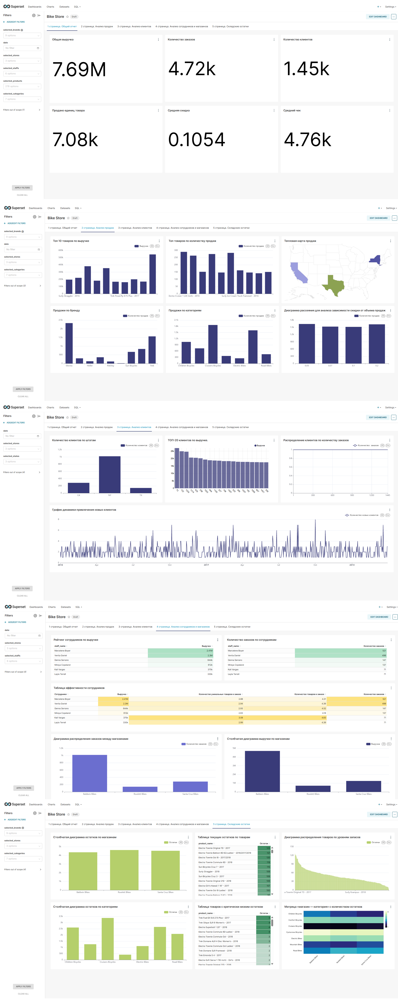

# Bike Store: Пайплайн и витрины данных для розничной сети

Проект по работе со связанными реляционными таблицами магазина спортивных товаров (клиенты, магазины, сотрудники, остатки, заказы и чеки).

## Что внутри папки

* `dags/` — DAG для Airflow (`data_pipeline_dag.py`).
* `datasets_for_superset/` — SQL-запросы для виртуальных датасетов в Superset.
* `dashboards/` — скриншот готового дашборда в Apache Superset.

## Как устроен сбор данных (Airflow)

Датасет забирается через Kaggle API по расписанию или вручную. 

Особенности пайплайна:
* **Соблюдение внешних ключей (FK):** таблицы загружаются строго по цепочке — сначала справочники (`brands`, `categories`, `stores`), затем `products`, `orders` и в конце позиции заказов `order_items`.
* **Очистка перед заливкой:** перед вставкой выполняется транзакционный `TRUNCATE ... CASCADE`, чтобы не дублировать строки при повторных прогонах.
* **Удаление мусора:** временные CSV-файлы удаляются в отдельном таске даже в случае падения пайплайна (`trigger_rule="all_done"`).

## Моделирование витрин (`datasets_for_superset/`)

Вместо одного тяжелого запроса данные разделены на три логические витрины:

1. **`dm_sales_performance`** (строка чека) — продажи с учетом скидок, география магазинов, привязка к продавцам и категориям товаров.
2. **`dm_customer`** (клиент за выбранный период) — выручка, средний чек и деление на `New` / `Returning` на основе реальной даты первой покупки за всю историю базы.
3. **`dm_inventory_stocks`** (товар на складе магазина) — учет остатков и автоматический расчет статуса дефицита (`Отсутствует`, `Критически низкий`, `Достаточный`).

## Дашборд в Apache Superset

