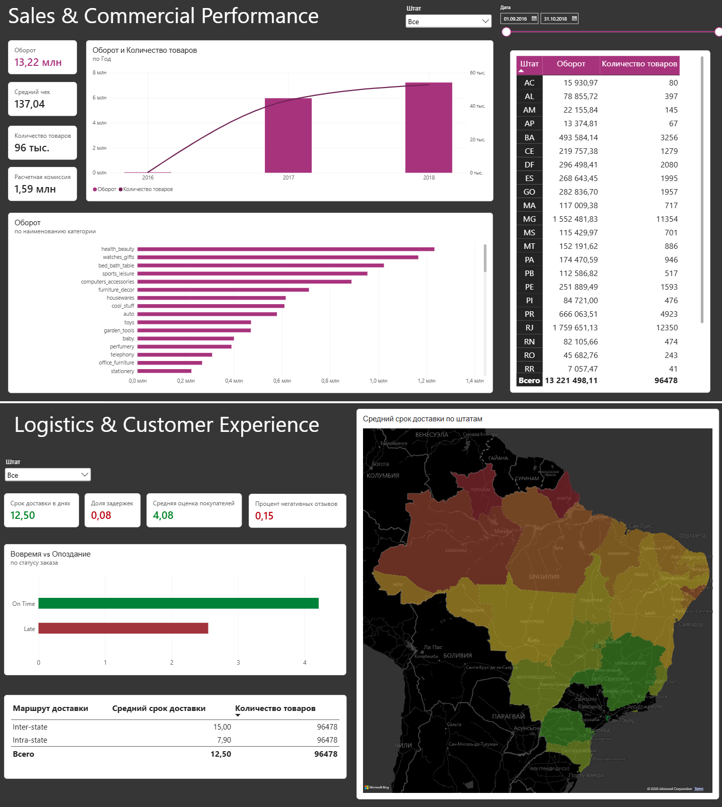

# Olist E-Commerce: Потоковый ETL, когорты и анализ доставки

Исследование данных бразильского маркетплейса Olist (~100 000 заказов). Проект включает загрузку данных в сырой слой Postgres, проверку продуктовых гипотез в Python и отчет в PowerBI.

## Что внутри папки

* `dags/` — DAG для загрузки 9 CSV-файлов датасета в PostgreSQL.
* `sql/` — DDL создания схемы `raw` и проверочные выборки.
* `python_analysis/` — Jupyter Notebook с аналитикой (когорты, RFM, статтесты).
* `dashboards/` — скриншот отчета PowerBI.

## Пайплайн загрузки (Airflow)

Так как датасет содержит крупные таблицы (сотни тысяч строк отзывов, геолокаций и товаров), стандартный `to_sql()` из pandas работал слишком медленно.

Как оптимизирована загрузка:
* Данные читаются в DataFrame, пустые значения приводятся к `\N`, после чего поток передается напрямую в PostgreSQL через буфер в памяти (`io.StringIO`) и команду `COPY FROM STDIN`.
* Поскольку в сыром слое нет внешних ключей, таблицы грузятся параллельно.

## Анализ данных в Jupyter Notebook

1. **Когортный анализ (Retention Rate):**
   * Расчет повторных покупок по месяцам.
   * **Вывод:** очень маленькое удержание клиентов. Для маркетплейса с редкими покупками длительного пользования это норма, бизнес-модель полностью держится на привлечении нового трафика.

2. **RFM-сегментация:**
   * Клиенты разбиты на группы.
   * Оценка распределения выручки: топ-сегменты постоянных покупателей приносят непропорционально большую часть оборота по сравнению со своей долей в базе.

3. **Влияние задержки доставки на оценки (Гипотеза):**
   * Распределение оценок (`review_score`) для заказов вовремя и с опозданием.
   * Из-за сильного скоса распределения (оценки 1–5) применен критерий Манна-Уитни.
   * **Результат:** средняя оценка при опоздании падает с с 4.29 до 2.55 балла, а доля негатива (1–2 звезды) вырастает с 9% до более чем 50%. Нарушение сроков доставки - ключевой драйвер негативных отзывов.

## Отчет в PowerBI

